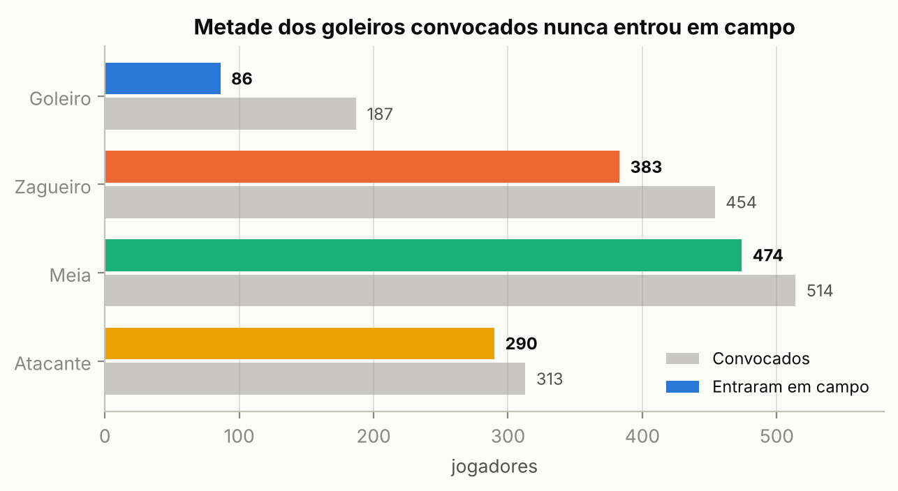
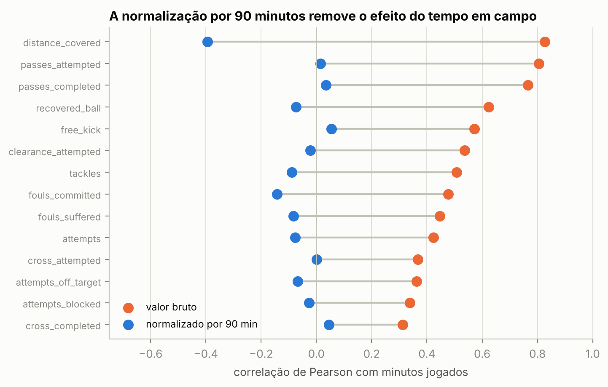
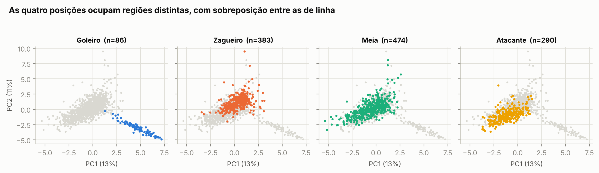

# Análise Exploratória de Dados — UEFA Nations League 2026/27

Trabalho 1 da disciplina **ELE0604 - Redes Neurais Artificiais** (DEE / UFRN).

Análise exploratória do conjunto de dados da UEFA Nations League 2026/27, preparando um
problema de classificação supervisionada para o trabalho seguinte: **descobrir a posição
tática de um jogador a partir das suas estatísticas de desempenho em campo**.

**Autores:** Leonardo Barbosa e Matheus Salviano
**Professor:** Allan Martins

| | |
|---|---|
| Notebook | [`eda_uefa_nations_league.ipynb`](eda_uefa_nations_league.ipynb) |
| Relatório | [`relatorio_eda_uefa.pdf`](relatorio_eda_uefa.pdf) |
| Conjunto preparado | [`dados_preparados.npz`](dados_preparados.npz) |

---

## O problema

A hipótese é que a função tática de um jogador deixa uma assinatura estatística: o goleiro
defende, o zagueiro corta, o meia distribui e o atacante finaliza. Se isso for verdade, uma
rede densa deve conseguir recuperar a posição a partir das métricas de jogo.

| | |
|---|---|
| Tarefa | Classificação multiclasse (`GOALKEEPER`, `DEFENDER`, `MIDFIELDER`, `FORWARD`) |
| Amostras | 1.233 jogadores (após limpeza) |
| Variáveis de entrada | 25 métricas normalizadas por 90 minutos |
| Modelo do trabalho 2 | MLP densa, saída `softmax`, treinamento por backpropagation |
| Baseline a superar | 38,4% (classe majoritária `MIDFIELDER`) |

Das sete tabelas do dataset, apenas `players_summary.csv` tem volume compatível com o
treinamento de uma rede: as tabelas de time e de classificação têm 54 linhas e as de
partidas, 104. As tabelas `*_latest` parecem maiores, mas são a mesma informação em formato
longo (8 categorias por jogador).

## Principais achados

**1. 16% das linhas não têm dado nenhum.** 235 jogadores foram convocados mas nunca
entraram em campo, e aparecem com nulo em todas as métricas. Entre os goleiros isso chega a
54%, consequência direta de cada seleção levar três e usar um.



**2. O tempo em campo dominava todas as contagens.** Os minutos jogados variam de 1 a 360,
e sem corrigir isso a rede aprenderia a separar titular de reserva em vez de zagueiro de
meia. A normalização por 90 minutos é a transformação mais importante de toda a preparação.



**3. O dataset tem erros reais na fonte.** Testes de identidade estrutural
(`goals` = soma das quatro colunas por parte do corpo, `attempts` = soma de três) revelaram
cinco linhas que não fecham. Além disso `passes_accuracy` não é reprodutível a partir de
`passes_completed / passes_attempted`: só 59% das linhas ficam dentro de ±1 p.p. do valor
recalculado, e há jogadores com 100% de aproveitamento gravados como 50%.

**4. A classe `GOALKEEPER` é trivialmente separável.** A regra `saves > 0` acerta 95,3% dos
goleiros e nunca dispara em jogador de linha (0 de 1.147). A acurácia global do modelo vai
parecer alta por causa disso, então o trabalho 2 precisa reportar a matriz de confusão e
rodar um experimento paralelo apenas com jogadores de linha.

**5. Nem toda intuição de futebol se confirma.** Desarmes por 90 minutos quase não separam
posição (F = 3,4, contra F = 1251 das defesas): zagueiros e meias desarmam em taxa
equivalente. O que distingue o zagueiro é o corte, não o desarme.

**6. As fronteiras entre as classes de linha não são lineares.** Na projeção PCA os goleiros
formam um braço apartado, enquanto zagueiro, meia e atacante se distribuem em um gradiente
com forte sobreposição. As duas primeiras componentes explicam apenas 23,7% da variância e
são necessárias 10 para chegar a 66%, o que justifica tecnicamente uma MLP com camada oculta
em vez de um classificador linear.



## Variáveis descartadas

Saíram 18 das 44 colunas, por quatro critérios:

| Critério | Quantidade | Exemplos |
|---|---|---|
| Identificação | 5 | `player_id`, `team_name`, `country_code` |
| Suporte inferior a 2% | 5 | `punches` (constante zero), `goals_scored_other` (5 observações) |
| Redundância estrutural | 6 | `goals` (soma exata de outras 4), `passes_completed` (r = 0,98) |
| Exposição | 2 | `minutes_played_official`, `matches_appearance` (viraram denominador) |

O detalhamento de cada descarte está na seção 4.2 do relatório.

## Estrutura do repositório

```
.
├── eda_uefa_nations_league.ipynb   notebook com toda a análise
├── relatorio_eda_uefa.pdf          relatório entregue (13 páginas)
├── relatorio.md                    fonte do relatório (pandoc + xelatex)
├── dados_preparados.npz            treino/validação/teste padronizados, rótulos em one-hot
├── features_finais.csv             as 25 variáveis selecionadas
├── dados/                          os 7 CSV originais do Kaggle
└── figuras/                        gráficos gerados pelo notebook
```

## Como executar

### O notebook

```bash
pip install pandas numpy matplotlib scipy scikit-learn jupyter
jupyter notebook eda_uefa_nations_league.ipynb
```

O notebook procura os CSV em `dados/` e, se não encontrar, no próprio diretório. Rodando as
células de cima para baixo ele refaz toda a análise, regrava os seis gráficos em `figuras/`
e salva `dados_preparados.npz`.

### O relatório

`relatorio.md` é a fonte do `relatorio_eda_uefa.pdf`, o documento de 13 páginas entregue na
disciplina. Ele consome as figuras de `figuras/`, as mesmas que aparecem neste README, então
rode o notebook antes se quiser regerar tudo do zero:

```bash
pandoc relatorio.md -o relatorio_eda_uefa.pdf --pdf-engine=xelatex \
  -V mainfont="DejaVu Serif" -V monofont="DejaVu Sans Mono"
```

Resumindo o encadeamento: `dados/` → notebook → `figuras/` + `dados_preparados.npz`, e daí
`relatorio.md` + `figuras/` → PDF.

## Carregando o conjunto preparado

```python
import numpy as np

d = np.load("dados_preparados.npz", allow_pickle=True)
X_train, y_train = d["X_train"], d["y_train"]   # (863, 25) e (863, 4) em one-hot
X_val,   y_val   = d["X_val"],   d["y_val"]     # (185, 25)
X_test,  y_test  = d["X_test"],  d["y_test"]    # (185, 25)
classes  = d["classes"]                          # ordem das colunas do one-hot
features = d["features"]
```

A divisão é estratificada (70 / 15 / 15), e a winsorização em p1-p99 e a padronização foram
ajustadas apenas no conjunto de treino.

## Pendências para o trabalho 2

- Imputar `top_speed` e `distance_covered` (5,7% de ausência) pela mediana global, ajustada
  somente no treino. Usar a mediana da posição seria vazamento do rótulo.
- Tratar o desbalanceamento de `GOALKEEPER` (86 amostras, 7%) com pesos de classe na função
  de custo.
- Rodar um experimento restrito a jogadores de linha, sem a classe trivialmente separável.
- Testar um piso mínimo de minutos jogados, para medir o efeito das taxas infladas por
  amostra curta.

## Fonte dos dados

SUBHASH B. *UEFA Nations League 2026*. Kaggle, 2026. Licença CC BY-SA 4.0.
<https://www.kaggle.com/datasets/subhashb21022/uefa-nations-league-2026>

Os dados originais foram coletados pelo autor a partir dos endpoints oficiais da UEFA
(`compstats.uefa.com` e `match.uefa.com`). Os CSV em `dados/` são redistribuídos aqui sob a
mesma licença.
